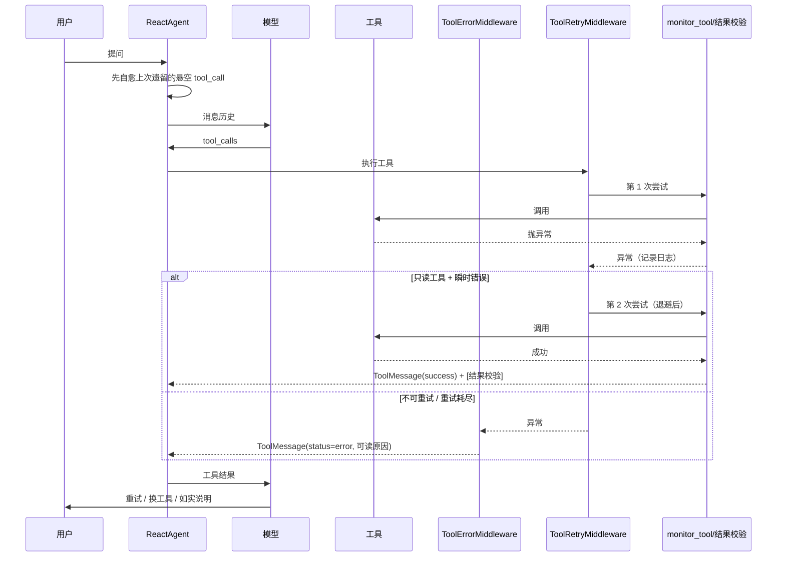

# 01 · 入门讲解：工具失败后，Agent 为什么不再“停一次就结束”

> 读者：第一次接触 LangChain / LangGraph 的同学，或者要给同事讲这套代码的人。
> 前置：只需要知道“模型会返回一个工具调用请求，程序执行工具，再把结果发回模型”这件事。
> 事实来源：本次改造后的代码（以代码为准），以及 `docs/agent-resilience/evidence/` 下的验证快照。

---

## 0. 一句话结论

项目**一直用的是 ReAct Agent，也一直有 agent loop**。
“失败一次就不继续”不是没循环，而是四个问题叠在一起：

1. 循环要不要继续，完全由模型自己决定，没有“任务没完成就再来一次”的校验层；
2. 提示词原来明确写着“不要重试同一个调用”；
3. 工具把失败吞成了空字符串或中文提示，模型看不出“这一步失败了”；
4. 工具一旦**抛异常**，异常会一路冒泡，整轮 run 直接中断，loop 连下一轮都进不去。

本次改造把第 2、3、4 条修掉，并给第 1 条补上“有限重试 + 结果校验 + 会话自愈”三件工具。

---

## 1. 先建立正确的图：一次工具调用到底怎么走

```
用户输入
   │
   ▼
[model 节点]  ←──────────┐
   │ 有 tool_calls?       │
   ├─ 没有 → 结束（给用户回答）
   │ 有                   │
   ▼                      │
[tools 节点] 执行工具        │
   │ 生成 ToolMessage      │
   └──────────────────────┘
```

这张图由 `create_agent(...)` 生成，见 `agent/react_agent.py` 里的 `ReactAgent.__init__`。
`create_agent` 把 `recursion_limit` 设成 9999，所以**不是“轮数不够”**。

关键点：**图只负责“模型要不要再调一次工具”，它不负责“任务是否成功”。**
模型看到工具结果后，如果决定“好了，我总结一下”，循环就结束了——哪怕这次工具是失败的。
所以“失败后要不要重试”本质上是**模型的行为**，而模型的行为由三样东西塑造：工具结果长什么样、提示词怎么写、异常有没有被兜住。

---

## 2. 四个根因，逐一对照代码

### 2.1 根因一：没有“任务完成校验”，只有“模型还想不想调工具”

LangGraph 的 ReAct 图没有“目标达成判定”节点。这不是 bug，是设计：
它假设模型能根据工具结果自己决定下一步。

要让它“失败后继续”，工程上有三种常见做法：

| 做法 | 说明 | 本项目是否采用 |
| --- | --- | --- |
| 错误可读 + 提示词允许有限重试 | 让模型自己判断 | ✅ 采用 |
| 中间件自动重试瞬时错误 | 不打扰模型 | ✅ 采用（只对只读工具） |
| 额外加一个“验收节点/多 Agent 评审” | 成本高、延迟高 | ❌ 非目标 |

### 2.2 根因二：提示词原来禁止重试

改造前 `prompts/main_prompt.txt` 第 83 行：

```text
工具失败时说明失败原因和可替代方案，不要静默重试同一个调用。
```

模型很听话，于是“失败 → 说明原因 → 结束”。

改造后：

```text
工具失败时先说明失败原因；同一次调用最多重试 1 次，且必须换参数、换路径或换等价工具；
仍然失败就给出可替代方案，不要反复重试同一个调用。
```

同时补了三条“错误结果怎么读”的规则（第 16–18 条）：错误消息、`[结果校验]`、`[未执行]` 分别代表什么。

### 2.3 根因三：工具把失败吞掉了（静默失败）

改造前 `agent/tools/agent_tools.py` 的 `web_search_baidu`：

```python
except Exception as e:
    logger.warning(...)
    return ""          # ← 401 只进了日志，模型收到一个空字符串
```

模型拿到空字符串，没有理由重试，只能说“没搜到”。

改造后：

- 没有 `API_KEY_BAIDU` → 直接抛 `RuntimeError`，明确告诉用户去补 `.env`；
- HTTP/网络错误 → `raise`，交给中间件判断“能不能重试”；
- 搜索成功但确实没有结果 → 返回一句可读说明`（百度搜索没有返回与「xxx」相关的可用结果）`，把“查不到”和“调用失败”分开。

### 2.4 根因四：工具抛异常时，整轮 run 会被打断（最致命）

这条链路改造前是这样的：

```
工具抛异常
  → monitor_tool 记录后 raise（agent/tools/middleware.py）
  → create_agent 建的 ToolNode 默认不兜底（langgraph/prebuilt/tool_node.py 的
     _default_handle_tool_errors 只处理 ToolInvocationError，其它继续 raise）
  → 异常冒到 app.py 的 except，界面只显示“生成回答失败”
  → 本轮结束，没有下一轮
```

更麻烦的是**副作用**：run 中断时 checkpoint 里会留下一条带 `tool_calls` 的 `AIMessage`，
却没有对应的 `ToolMessage`，图的 `next` 还停在 `tools`。下一次在同一个会话里提问，
这份“调用没有结果”的历史会被发给模型 API，常见后果是 400 报错或模型被带偏。
（这一点在 `tests/test_agent_resilience.py` 里有可复现用例。）

---

## 3. 改造后的调用链（重点）

```
模型返回 tool_calls
        │
        ▼
┌───────────────────────────────┐
│ ToolErrorMiddleware（最外层）   │  任何异常 → status="error" 的 ToolMessage
│  └ ToolRetryMiddleware         │  只对「只读工具 + 瞬时错误」重试 2 次
│     └ monitor_tool             │  日志 / 审计 / 结果校验
│        └ 真正的工具             │
└───────────────────────────────┘
        │
        ▼
ToolMessage 回到模型 → 模型看到真实结果 → 决定重试 / 换工具 / 向用户说明
```

顺序写死在 `agent/react_agent.py` 的 `middleware=[...]` 里，**列表越靠前越外层**。
这不是随便排的：

- 异常必须能被“最外层”接住，所以错误中间件排第一；
- 重试必须比“转成错误消息”更靠内，否则重试的就是“已经变成错误消息”的结果，没有意义；
- 日志/审计/校验必须在工具旁边，才能拿到真实参数与真实结果。

### 3.1 异常怎么变成“模型能读懂的错误消息”

`agent/tools/middleware.py`：

```python
tool_error_middleware = ToolErrorMiddleware(on_error=_tool_error_content)
```

`_tool_error_content()` 生成的内容长这样：

```text
工具 `computer_use` 执行失败（RuntimeError）：模拟工具崩溃（冒烟用）
本轮对话没有中断。请判断原因：参数问题就换参数；如果是瞬时故障，可以重新发起一次调用
（系统不会自动重试所有工具，所以不要在回答里声称“已重试”）；仍然失败就向用户说明，不要假装成功。
```

三个设计点：

1. **只给类型和一句话原因**，不把堆栈发给模型（堆栈进日志）；
2. **明确告诉模型“这一轮没中断”**，否则模型容易直接放弃；
3. **提前堵住“谎称已重试”**——这是我们真实冒烟时踩到的坑：模型看到“可以重试一次”，
   就在回答里说“已重试”，但其实它没有再发起调用。

### 3.2 重试规则：只重试“可能自己好起来”的错误

`_should_retry_tool_error()` 的白名单/黑名单：

| 情况 | 是否重试 | 原因 |
| --- | --- | --- |
| 连接超时、连接被重置、`TimeoutError` | ✅ | 典型瞬时故障 |
| HTTP 429 | ✅ | 限流，等一会儿可能就好 |
| HTTP 5xx | ✅ | 服务端临时故障 |
| HTTP 401 / 403 / 404 | ❌ | 密钥错、没权限、路径错，重试只会更慢更贵 |
| 参数错误（`ValueError` 等） | ❌ | 同样的参数再试一次还是错 |
| 文件不存在 | ❌ | 确定性失败 |

重试范围也有限制（`RETRYABLE_TOOLS`）：只对**幂等/只读**工具重试，例如
`web_search_baidu`、`read_text_file`、`list_directory`。
`write_text_file`（追加写）、`delete_path`、`computer_use`（点鼠标）**永远不自动重试**，
因为重试会放大副作用——"写两次"和"点两下"都可能造成真实损失。

参数：`max_retries=2`，初始等待 0.3s，指数退避，单次最多等 2s。

### 3.3 重试耗尽了怎么办

`on_failure="error"`：把异常抛给外层 `ToolErrorMiddleware`，最终变成错误 `ToolMessage`。
**不会**伪装成“成功但内容为空”。

---

## 4. 结果验证：工具说成功，就真的成功了吗

### 4.1 为什么需要

工具返回“已写入 5 个字符”只是它自己的说法。磁盘满、文件被占用、路径被换掉，
都可能让结果和事实不一致。模型没有眼睛，工具说什么它就信什么——然后写进回答误导用户。

### 4.2 做法：确定性后置校验

`agent/tools/verification.py` 在**工具执行之后、写审计之前**核对后置条件：

| 工具 | 核对什么 | 判定 |
| --- | --- | --- |
| `write_text_file` | 文件存在；回读内容与参数一致（追加则比对结尾） | 不一致 → `status="error"` |
| `create_directory` | 目录真的存在且是目录 | 不存在 → error |
| `move_path` | 源路径已消失且目标存在 | 任一不满足 → error |
| `copy_path` | 目标存在 | 不存在 → error |
| `delete_path` | 原路径已不存在 | 仍存在 → error |

三条硬约束：

1. **只验证“声称成功”的结果**（结果以 `已写入`/`已移动` 等开头才校验）；
   工具自己报错时不再重复校验，避免噪音。
2. **校验本身绝不抛异常**，查不了就跳过（`checked=False`）。
3. **不适用就不改**：非文件类工具原样返回。

### 4.3 结果长什么样

校验通过：

```text
已写入 5 个字符到 D:\...\note.txt

[结果校验] 已核对：文件内容与写入参数一致，文件存在，5 字节
```

校验不通过：

```text
已写入 5 个字符到 D:\...\missing.txt

[结果校验未通过] 目标文件不存在：D:\...\missing.txt
工具声称成功，但后置检查没有通过；请先确认目标的真实状态，再决定是否重试。
```

第二条会同时把 `ToolMessage.status` 改成 `error`，于是：

- 模型看到“未通过”，不会照抄成功结论；
- 聊天页「本次操作记录」显示“未完成”；
- `logs/audit_YYYYMMDD.jsonl` 里这条记录的状态也是 `error`。

### 4.4 Windows 上的一个坑

Windows 文本写入会把 `\n` 变成 `\r\n`。如果直接逐字比较，**每次写入都会被误判为校验失败**。
所以比对前会统一换行符（`_normalize_newlines`），这一点有专门用例覆盖。

---

## 5. 会话自愈：上次崩了，下次还能不能接着聊

`agent/resilience.py` 做三件事：

1. `find_unanswered_tool_calls(messages)`：找出“有调用、没结果”的 `tool_call`；
2. `build_interrupted_tool_messages(calls)`：生成占位结果，内容以`[未执行]`开头，
   明确写“这次调用没有产生结果，不要假设成功”；
3. `repair_thread_state(graph, config)`：用 `update_state(..., as_node="tools")` 写回，
   让图的 `next` 从 `tools` 回到 `model`。

`ReactAgent.execute_stream()` 在提交新消息**之前**调用它，所以：

- 用户不需要点“清空记忆”；
- 模型不会收到“tool_calls 没有结果”的脏历史；
- 占位消息是 `error`，不会被当成成功。

> 注意：自愈补的是“没执行过”的事实，不是伪造一个成功结果。

---

## 6. 一次失败从发生到收尾（改造后）



---

## 7. 复盘四问

### 7.1 做了什么

给 ReAct 循环补上“失败可见、有限重试、结果可核、中断可续”四件事，全部通过中间件与独立模块实现，不改 LangGraph 主流程。

### 7.2 证据是什么

- 离线用例：20 条全绿（`scripts/verify_agent_resilience.py`，证据见 `evidence/verify-*.json`）；
- 真实链路冒烟 3 次：
  - 只读工具成功：`computer_use` → 回答“1920 x 1080”；
  - 联网搜索成功：`web_search_baidu` → 返回结果并总结；
  - 工具抛异常：`computer_use` 被替换为必崩实现 → 产出 `status=error`，模型继续回答，整轮未崩。
- 具体命令与输出见 `02-验证与交付复盘.md`。

### 7.3 哪里还不完善

- 校验只覆盖 5 个文件类工具；`run_command` 的退出码、`computer_use` 的画面结果仍靠模型判断；
- 重试只覆盖会抛异常的工具；`os_tools` 内部把失败转成字符串，不会触发重试（这是有意的：它们是确定性失败）；
- 自愈依赖节点名 `tools`，升级 LangChain 需要回归；
- 没有 CI，验证脚本是手动跑的。

### 7.4 下一步

1. 把 `verify_agent_resilience.py` 挂到 pre-push 或 GitHub Actions；
2. 给 `run_command` 增加“退出码非 0 → 状态 error”的口径（需要先确认哪些非 0 是正常的）；
3. 把“结果校验”扩展到 `computer_use` 的截图（核对文件确实生成）。

---

## 8. 排障 FAQ

**Q：我看到“生成回答失败”，日志在哪？**
A：`logs/agent_YYYYMMDD.log`。本次改造后 `app.py` 会用 `logger.exception` 记录完整堆栈，
界面只保留一句简短提示。

**Q：模型说“已重试”，但操作记录里只有一条，为什么？**
A：模型在编。除了 `RETRYABLE_TOOLS` 里的只读工具，系统不会自动重试；
提示词和错误消息都要求它“要重试就真的再发起一次调用”。

**Q：为什么写文件失败不自动重试？**
A：写文件（尤其是 `append`）、删除、移动、点击都不幂等。自动重试可能造成重复写入或误操作，
这类操作的兜底是“人工确认 + 结果校验 + 如实报错”。

**Q：同一个会话之前崩过一次，现在还能继续吗？**
A：可以。下次提问前会先补齐上次的悬空调用；日志里会有一条
`[resilience]已为上次中断遗留的 N 个工具调用补占位结果`。

**Q：怎么自己跑一遍验证？**
A：

```powershell
.\.venv\Scripts\python.exe scripts\verify_agent_resilience.py
```

---

## 9. 想继续读代码，按这个顺序

1. `agent/react_agent.py`：中间件顺序、`execute_stream` 里的自愈入口；
2. `agent/tools/middleware.py`：错误转消息、重试规则、`monitor_tool` 的结果校验；
3. `agent/tools/verification.py`：五类文件操作的后置条件；
4. `agent/resilience.py`：悬空调用识别与修复；
5. `tests/`：每条行为的可执行说明。
